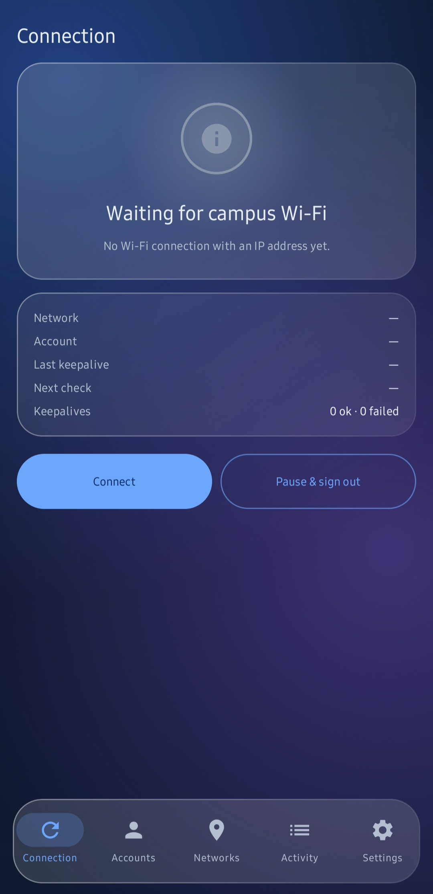
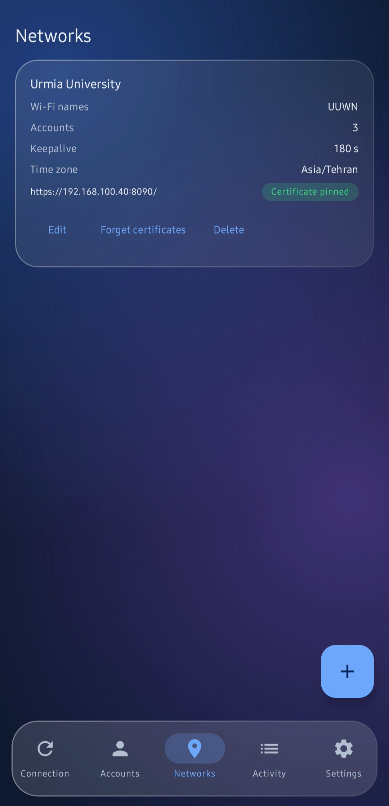
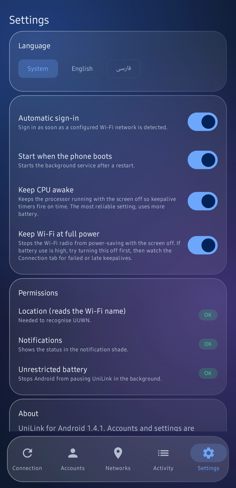

<div align="center">

# UniLink for Android

**Stay signed in to your university Wi-Fi: automatically, reliably, and without touching the browser.**

[](../../actions/workflows/build-apk.yml)
[](../../releases/latest)


[**Download the latest APK**](../../releases/latest) · [فارسی](README_FA.md) · [Changelog](CHANGELOG.md)

</div>

---

UniLink signs you in to Sophos / Cyberoam captive portals (built for Urmia University's **UUWN**) and keeps the session alive in the background. It is the Android companion to the Windows version of UniLink.

Phones close browser tabs, sleep the screen and often run a VPN, and each of those breaks a portal session. UniLink does the sign-in itself from a lightweight background service, so none of that matters.

## Features

| | |
|---|---|
| **VPN-safe** | Portal traffic is bound to the physical Wi-Fi interface, so it works while a VPN is on. If your VPN forbids that, UniLink retries over the VPN route and tells you what to change (see [Troubleshooting](#troubleshooting)). The system proxy is ignored. |
| **Multiple accounts** | Accounts are tried one at a time, in your order. When the portal reports the monthly allowance is used up, the account is skipped until the next month (Asia/Tehran time by default) and the next one is used. |
| **Smart error handling** | A rejected password blocks only that account. Network errors and unknown replies are retried with growing delays and never burn an account. |
| **Certificate pinning** | The portal uses a self-signed certificate. UniLink shows its SHA-256 fingerprint once, you approve it, and from then on only that certificate is accepted. No password is sent before approval. |
| **Redirects refused** | The portal can't bounce your credentials to another address. |
| **Encrypted storage** | Accounts and settings are encrypted with a key held in the Android Keystore and never leave the phone. |
| **Runs in the background** | Foreground service with a persistent notification, optional wake lock, and start on boot. |
| **Persian and English** | Full Persian interface with right-to-left layout, or English. Follows the phone's language, or choose in Settings. |
| **Quick tile, widget and checklist** | A Quick Settings tile and a small home-screen widget to connect or pause, and a first-run checklist that walks you through permissions. |
| **Glass interface** | Frosted-glass cards over a gradient backdrop, in light and dark themes that follow the phone. |
| **Keeps existing sessions** | If the portal already has a live session for your account, UniLink keeps it alive instead of signing in again. |
| **Diagnostics** | In-memory activity log you can share. Passwords and student numbers are never logged. |

## Screenshots

| Connection | Networks | Settings |
|---|---|---|
|  |  |  |

## Install

1. Open the [latest release](../../releases/latest) on your phone and download `UniLink-vX.Y.Z.apk`.
2. Open the file and allow **Install unknown apps** if Android asks.
3. Allow **Location** (Android only reveals the Wi-Fi name to apps that have it; location is never stored or sent), **Notifications**, and **Unrestricted battery** so Android doesn't pause the service.
4. **Accounts** tab → **+** → add your student number and password.
5. Connect to `UUWN`. On the **Connection** tab a certificate card appears: compare the fingerprint with the one your browser shows on the normal login page, then tap **Trust this certificate**.

After that it signs in on its own whenever you're on campus Wi-Fi. From v1.5.0 on, releases are signed with a private key, so new versions install over old ones and keep your accounts and settings. (Moving from an older version to 1.5.0 needs a one-time uninstall and re-add of your accounts, because the signing key changed.)

Optionally add the **Quick Settings tile** (edit the quick panel) or the **home-screen widget** (long-press the home screen → Widgets → UniLink).

## The five tabs

- **Connection**: current state, active account, last keepalive, Connect / Pause & sign out.
- **Accounts**: add, edit, reorder, disable, set default, clear a block.
- **Networks**: Wi-Fi names, portal URLs, keepalive interval (30–180 s), time zone, extra quota phrases, pinned certificates.
- **Activity**: what happened and why, with a share button.
- **Settings**: automatic sign-in, start on boot, wake lock, permission shortcuts.

## Battery

UniLink keeps a background service running, so it does use some battery. Settings has two switches to tune that:

- **Keep CPU awake** keeps keepalive timers on time with the screen off. Most reliable, most power.
- **Keep Wi-Fi at full power** stops the Wi-Fi radio from power-saving with the screen off.

To find your lightest reliable setting: run a day with both on, a day with only Wi-Fi power off, and compare UniLink's share in phone **Settings → Battery**. The Connection tab counts successful, failed and late keepalives, so you can tell whether a change cost reliability.

## Troubleshooting

**It stopped working while my VPN is on** (the log says `Binding socket to network … EPERM`)
Some VPN apps, in strict mode, forbid other apps from connecting to the Wi-Fi directly. Best fix: in your VPN app, **exclude UniLink from the tunnel** (split tunneling / bypass apps / per-app VPN), or turn on **Allow LAN / bypass local network**. Since v1.4.1 UniLink also retries over the VPN route, checks again every minute at most, and reacts at once when a VPN starts or stops.

**"Waiting for campus Wi-Fi" although I'm connected**
Allow **Location** (Android hides the Wi-Fi name without it), or turn on portal-only matching for the network on the **Networks** tab.

**No status notification**
Notifications may be blocked for the app; the checklist on the Connection tab and **Settings → Permissions** show the real state.

**Anything else**
Open an issue and paste the **Share log** output from the **Activity** tab. Passwords and student numbers are never in it.

## Build it yourself

You don't need Android Studio: push the repo to GitHub and the **Build APK** workflow builds it for you.

- Every push to `main` produces a minified release APK (`UniLink-release-apk`) and an unminified debug APK (`UniLink-debug-apk`, a fallback) under **Actions → latest run → Artifacts**.
- Pushing a tag such as `v1.0.2` also publishes a **GitHub Release** with the APK and its SHA-256:

```bash
git tag v1.0.2
git push origin v1.0.2
```

Locally: open the folder in Android Studio (JDK 17, Android SDK 35) and press Run, or use the included Gradle wrapper (`./gradlew assembleRelease`, Gradle 8.9).

Releases are signed with a private key kept in GitHub Secrets; the workflow refuses to publish anything signed with the public debug key. Builds without that key (forks, local) fall back to the public `app/debug.keystore`, which is for testing only. See [SECURITY.md](SECURITY.md) to verify a download's signing certificate.

## Status and limitations

- The portal protocol was reimplemented from the Windows version's documented behavior and has been used day to day on UUWN. Portals that reply differently may need small adjustments. If something doesn't work, open an issue with the **Share log** output from the Activity tab.
- If a VPN blocks the local network or direct Wi-Fi access, exclude UniLink from the VPN or allow LAN (see Troubleshooting).
- Android only. There is no iOS version: iOS can't keep a background session alive the way this app does.
- Activity log lines are English only (by design, so they are easy to share).

## Roadmap

Import/export of network profiles · per-account usage notes · more battery tuning · IzzyOnDroid and F-Droid listing (in progress)

## Security

See [SECURITY.md](SECURITY.md) for how releases are signed (with the fingerprint to check), how to report a vulnerability, and how your data is handled.

## License

UniLink is free software, licensed under the **GNU GPL v3 or later**. See [LICENSE](LICENSE).

## Disclaimer

UniLink is an independent, unofficial project. It is not affiliated with or endorsed by any university or by Sophos. Use it only with accounts you are authorized to use, and follow your institution's network policy.
