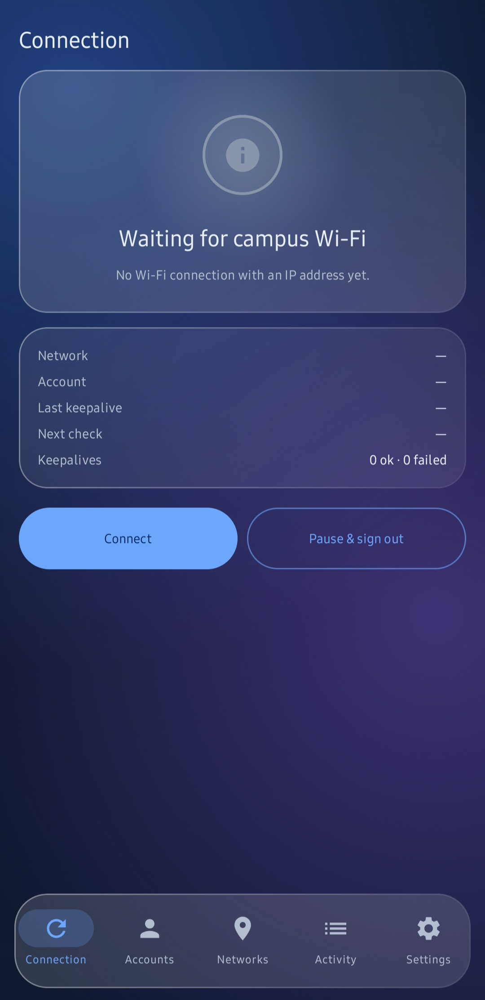
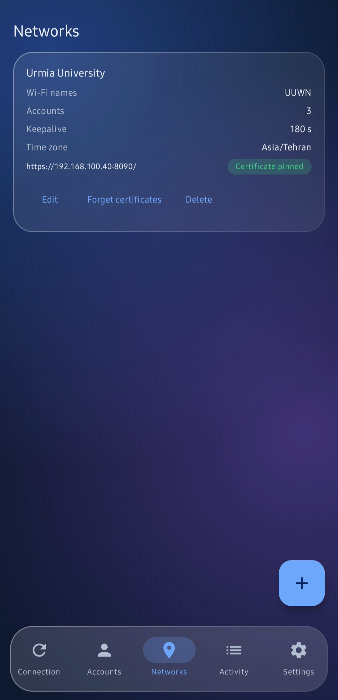
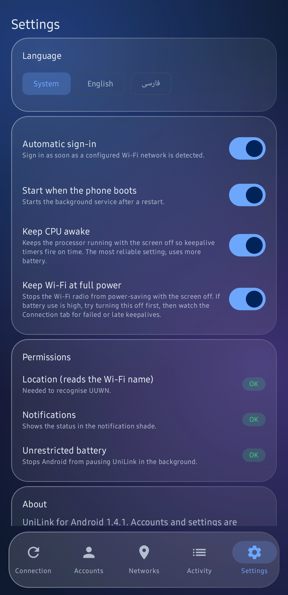

<div align="center" dir="rtl">

# UniLink برای اندروید

**همیشه به وای‌فای دانشگاه وصل بمان؛ خودکار، پایدار و بدون باز کردن مرورگر.**

[**دانلود آخرین APK**](../../releases/latest) · [English](README.md) · [تغییرات نسخه‌ها](CHANGELOG.md)

</div>

<div dir="rtl">

---

UniLink وارد پرتال‌های Sophos / Cyberoam می‌شود (برای شبکهٔ **UUWN** دانشگاه ارومیه ساخته شده) و نشست را در پس‌زمینه زنده نگه می‌دارد. این برنامه همتای اندرویدی نسخهٔ ویندوز UniLink است.

گوشی تب‌های مرورگر را می‌بندد، صفحه را خاموش می‌کند و اغلب VPN هم روشن است، و هرکدام نشست پرتال را قطع می‌کنند. UniLink ورود را خودش از یک سرویس سبک پس‌زمینه انجام می‌دهد، پس این‌ها دیگر مشکلی نیستند.

## امکانات

| | |
|---|---|
| **سازگار با VPN** | ترافیک پرتال به کارت وای‌فای فیزیکی بسته می‌شود و با VPN روشن کار می‌کند. اگر VPN این را ممنوع کند، UniLink از مسیر VPN دوباره امتحان می‌کند و می‌گوید چه باید کرد (بخش [عیب‌یابی](#عیبیابی)). پروکسی سیستم نادیده گرفته می‌شود. |
| **چند حساب** | حساب‌ها یکی‌یکی و به ترتیب تو امتحان می‌شوند. وقتی پرتال بگوید حجم ماهانه تمام شده، آن حساب تا ماه بعد (به وقت تهران) کنار می‌رود و حساب بعدی استفاده می‌شود. |
| **مدیریت هوشمند خطا** | رمز اشتباه فقط همان حساب را مسدود می‌کند. خطای شبکه و پاسخ ناشناخته با تأخیر افزایشی دوباره امتحان می‌شود و هیچ حسابی را از دست نمی‌دهد. |
| **پین کردن گواهی** | پرتال گواهی خودامضا دارد. UniLink اثر انگشت SHA-256 را یک‌بار نشان می‌دهد، تو تأیید می‌کنی و از آن به بعد فقط همان گواهی پذیرفته می‌شود. قبل از تأیید هیچ رمزی ارسال نمی‌شود. |
| **رد ریدایرکت** | پرتال نمی‌تواند اطلاعات ورود را به آدرس دیگری هدایت کند. |
| **ذخیره‌سازی رمزنگاری‌شده** | حساب‌ها و تنظیمات با کلید Android Keystore رمز می‌شوند و از گوشی بیرون نمی‌روند. |
| **اجرا در پس‌زمینه** | سرویس Foreground با نوتیفیکیشن پایدار، قفل بیداری اختیاری و اجرا هنگام روشن شدن گوشی. |
| **فارسی و انگلیسی** | رابط کامل فارسی با چیدمان راست‌به‌چپ، یا انگلیسی. از زبان گوشی پیروی می‌کند یا در تنظیمات انتخاب می‌شود. |
| **تایل، ویجت و چک‌لیست** | تایل Quick Settings و ویجت کوچک صفحهٔ اصلی برای اتصال یا توقف، و چک‌لیست اولین اجرا که اجازه‌ها را قدم‌به‌قدم می‌گیرد. |
| **رابط شیشه‌ای** | کارت‌های شیشه‌ای مات روی پس‌زمینهٔ گرادیانی، با تم روشن و تاریک که از گوشی پیروی می‌کند. |
| **حفظ نشست موجود** | اگر پرتال برای حساب تو نشست زنده داشته باشد، UniLink آن را زنده نگه می‌دارد و دوباره وارد نمی‌شود. |
| **عیب‌یابی** | لاگ فعالیت (فقط در حافظه) که می‌توانی به اشتراک بگذاری. رمز و شمارهٔ دانشجویی هرگز در لاگ نمی‌آید. |

## تصاویر

| اتصال | شبکه‌ها | تنظیمات |
|---|---|---|
|  |  |  |

## نصب

1. [آخرین Release](../../releases/latest) را روی گوشی باز کن و فایل `UniLink-vX.Y.Z.apk` را دانلود کن.
2. فایل را باز کن و اگر اندروید خواست، **Install unknown apps** را اجازه بده.
3. این اجازه‌ها را بده: **Location** (اندروید نام وای‌فای را فقط به برنامه‌هایی می‌دهد که آن را دارند؛ موقعیت هرگز ذخیره یا ارسال نمی‌شود)، **Notifications** و **Unrestricted battery** تا اندروید سرویس را متوقف نکند.
4. تب **Accounts** ← **+** ← شمارهٔ دانشجویی و رمز را وارد کن.
5. به `UUWN` وصل شو. در تب **Connection** کارت گواهی ظاهر می‌شود. اثر انگشت را با چیزی که مرورگر در صفحهٔ معمول ورود نشان می‌دهد مقایسه کن و **Trust this certificate** را بزن.

از این به بعد هر وقت به وای‌فای دانشگاه وصل شوی، خودش وارد می‌شود. از نسخهٔ ۱٫۵٫۰ به بعد انتشارها با یک کلید خصوصی امضا می‌شوند، پس نسخهٔ جدید روی قبلی نصب می‌شود و حساب‌ها و تنظیمات می‌مانند. (رفتن از نسخه‌های قدیمی‌تر به ۱٫۵٫۰ یک‌بار حذف و نصب مجدد و اضافه کردن دوبارهٔ حساب‌ها می‌خواهد، چون کلید امضا عوض شده.)

دلخواه: **تایل Quick Settings** را اضافه کن (ویرایش پنل سریع) یا **ویجت صفحهٔ اصلی** را (نگه داشتن صفحهٔ اصلی ← ویجت‌ها ← UniLink).

## پنج تب برنامه

- **Connection**: وضعیت فعلی، حساب فعال، آخرین keepalive، دکمه‌های Connect و Pause & sign out.
- **Accounts**: افزودن، ویرایش، جابه‌جایی ترتیب، غیرفعال کردن، تعیین پیش‌فرض و رفع انسداد.
- **Networks**: نام وای‌فای، آدرس پرتال، فاصلهٔ keepalive (۳۰ تا ۱۸۰ ثانیه)، منطقهٔ زمانی، عبارت‌های اضافهٔ اتمام حجم و گواهی‌های پین‌شده.
- **Activity**: چه اتفاقی افتاده و چرا، با دکمهٔ اشتراک‌گذاری.
- **Settings**: ورود خودکار، اجرا هنگام بوت، قفل بیداری و میان‌بر اجازه‌ها.

## باتری

UniLink یک سرویس پس‌زمینه دارد، پس مقداری باتری مصرف می‌کند. در تنظیمات دو کلید برای تنظیم آن هست:

- **بیدار نگه داشتن پردازنده**: با صفحهٔ خاموش هم نگه‌داشت نشست را سر وقت نگه می‌دارد. مطمئن‌ترین حالت و پرمصرف‌ترین.
- **وای‌فای با توان کامل**: نمی‌گذارد با صفحهٔ خاموش، وای‌فای در حالت صرفه‌جویی برود.

برای پیدا کردن سبک‌ترین حالت مطمئن: یک روز هر دو روشن، یک روز فقط «وای‌فای با توان کامل» خاموش، و سهم UniLink را در **تنظیمات گوشی ← باتری** مقایسه کن. تب اتصال تعداد نگه‌داشت‌های موفق، ناموفق و دیرهنگام را می‌شمارد تا بفهمی تغییر به پایداری ضربه زده یا نه.

## عیب‌یابی

**با VPN روشن از کار افتاد** (در لاگ `Binding socket to network … EPERM` می‌بینی)
بعضی برنامه‌های VPN در حالت سخت‌گیر اجازه نمی‌دهند برنامه‌های دیگر مستقیم به وای‌فای وصل شوند. بهترین راه: در برنامهٔ VPN، **UniLink را از تونل مستثنا کن** (Split Tunneling / Bypass apps / Per-app VPN) یا **Allow LAN / Bypass local network** را روشن کن. از نسخهٔ ۱٫۴٫۱ UniLink از مسیر VPN هم دوباره امتحان می‌کند، حداکثر هر یک دقیقه چک می‌کند و با روشن یا خاموش شدن VPN بلافاصله واکنش نشان می‌دهد.

**وصلم ولی «Waiting for campus Wi-Fi» می‌ماند**
اجازهٔ **Location** را بده (اندروید بدون آن نام وای‌فای را پنهان می‌کند) یا در تب **Networks** تطبیق فقط با پرتال را روشن کن.

**نوتیفیکیشن وضعیت نیست**
شاید اعلان‌ها برای برنامه بسته باشد؛ چک‌لیست تب Connection و **Settings ← Permissions** وضعیت واقعی را نشان می‌دهند.

**مشکل دیگر**
یک Issue باز کن و خروجی **Share log** تب **Activity** را بگذار. رمز و شمارهٔ دانشجویی هرگز در آن نیست.

## ساخت از سورس

نیازی به Android Studio نیست؛ مخزن را در گیت‌هاب بگذار تا workflow **Build APK** آن را بسازد.

- هر push روی `main` یک APK release کوچک‌شده (`UniLink-release-apk`) و یک APK دیباگ جایگزین (`UniLink-debug-apk`) می‌سازد (**Actions ← آخرین اجرا ← Artifacts**).
- زدن یک تگ مثل `v1.0.2` یک **GitHub Release** هم با APK و SHA-256 آن منتشر می‌کند:

```bash
git tag v1.0.2
git push origin v1.0.2
```

محلی: پوشه را در Android Studio باز کن (JDK 17 و Android SDK 35) و Run بزن، یا از Gradle Wrapper داخل مخزن استفاده کن (`./gradlew assembleRelease`، نسخهٔ Gradle 8.9).

انتشارها با کلید خصوصی نگه‌داری‌شده در GitHub Secrets امضا می‌شوند و workflow از انتشار چیزی که با کلید عمومی دیباگ امضا شده باشد خودداری می‌کند. ساخت‌هایی که آن کلید را ندارند (fork و ساخت محلی) به `app/debug.keystore` عمومی برمی‌گردند که فقط برای آزمایش است. برای بررسی امضای فایل دانلودشده [SECURITY.md](SECURITY.md) را ببین.

## وضعیت و محدودیت‌ها

- پروتکل پرتال از روی رفتار مستند نسخهٔ ویندوز بازنویسی شده و در استفادهٔ روزمره روی UUWN کار کرده است. پرتال‌هایی که پاسخ متفاوت می‌دهند ممکن است به اصلاح کوچک نیاز داشته باشند. اگر چیزی کار نکرد، خروجی **Share log** تب Activity را در یک Issue بگذار.
- اگر VPN شبکهٔ محلی یا اتصال مستقیم به وای‌فای را می‌بندد، UniLink را از VPN مستثنا کن یا LAN را مجاز کن (بخش عیب‌یابی).
- فقط اندروید. نسخهٔ iOS وجود ندارد، چون iOS نمی‌گذارد نشست پس‌زمینه مثل این برنامه زنده بماند.
- خطوط گزارش (تب گزارش) عمداً همیشه انگلیسی‌اند تا اشتراک‌گذاری ساده باشد.

## نقشهٔ راه

ورود/خروج پروفایل شبکه · یادداشت مصرف هر حساب · بهینه‌سازی بیشتر باتری · ثبت در IzzyOnDroid و F-Droid (در حال انجام)

## امنیت

[SECURITY.md](SECURITY.md) را ببین: نحوهٔ امضای انتشارها (همراه اثر انگشت برای بررسی)، گزارش آسیب‌پذیری و نحوهٔ نگه‌داری اطلاعات تو.

## مجوز

UniLink نرم‌افزار آزاد است و با مجوز **GNU GPL نسخهٔ ۳ یا بالاتر** منتشر می‌شود. فایل [LICENSE](LICENSE) را ببین.

## سلب مسئولیت

UniLink پروژه‌ای مستقل و غیررسمی است و به هیچ دانشگاه یا شرکت Sophos وابسته نیست و از سوی آن‌ها تأیید نشده. فقط با حساب‌هایی استفاده کن که اجازهٔ استفاده‌شان را داری و سیاست شبکهٔ دانشگاهت را رعایت کن.

</div>
